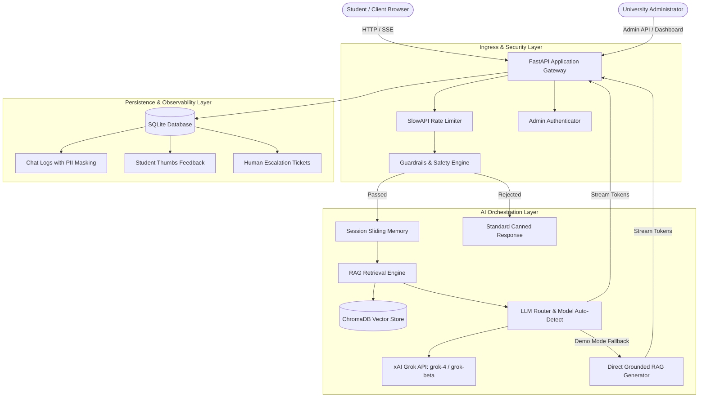
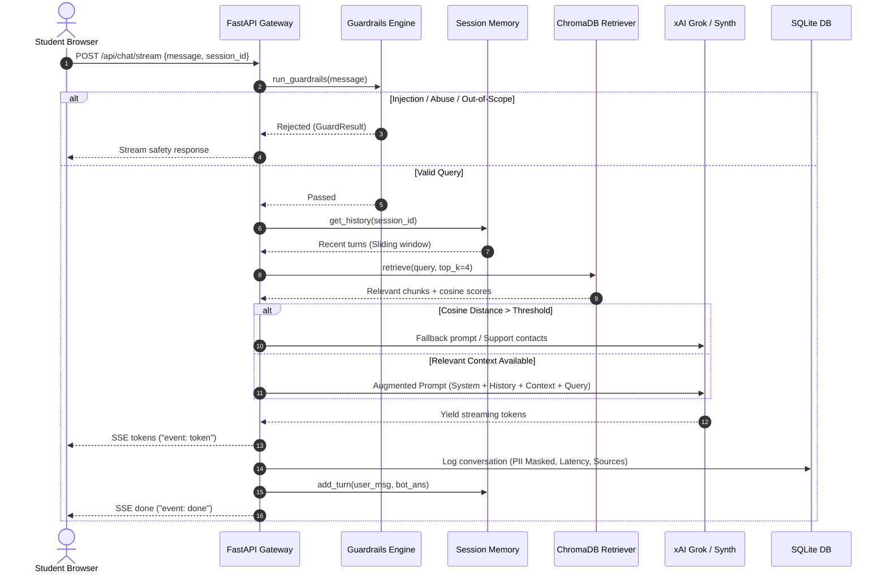

# UniAssist System Architecture Document
> Technical specification and architectural blueprints for UniAssist AI-Powered Student Support.

---

## 1. Architectural Overview

UniAssist is structured as a decoupled, layered micro-monolith designed for low-latency question answering, student privacy preservation, and strict domain grounding.

---

## 2. Core Processing Pipeline

When a user transmits a prompt via `/api/chat` or `/api/chat/stream`, the message undergoes an asynchronous 6-stage pipeline:

---

## 3. Data Models and Schemas

### 3.1 Relational Database (`uniassist.db`)

Built using SQLAlchemy 2.0:

1. **`chat_logs`**:
   - `id` (INTEGER, Primary Key)
   - `session_id` (VARCHAR, Indexed)
   - `question` (TEXT, PII-masked)
   - `answer` (TEXT)
   - `sources` (TEXT, JSON array of document references)
   - `is_fallback` (INTEGER, 1 if similarity fallback occurred)
   - `language` (VARCHAR, 'en' or multilingual code)
   - `latency_ms` (FLOAT, execution duration in milliseconds)
   - `created_at` (DATETIME, UTC timestamp)

2. **`feedback`**:
   - `id` (INTEGER, Primary Key)
   - `session_id` (VARCHAR)
   - `chat_log_id` (INTEGER, Foreign Key optional)
   - `question` (TEXT, PII-masked)
   - `answer` (TEXT)
   - `sources` (TEXT)
   - `rating` (VARCHAR, 'up' or 'down')
   - `created_at` (DATETIME)

3. **`tickets`**:
   - `id` (INTEGER, Primary Key)
   - `ticket_id` (VARCHAR, Unique, formatted `TICK-YYYYMMDD-XXXX`)
   - `name` (VARCHAR)
   - `student_id` (VARCHAR)
   - `email` (VARCHAR, PII-masked in logs)
   - `query` (TEXT)
   - `status` (VARCHAR, 'open' or 'resolved')
   - `created_at` (DATETIME)
   - `resolved_at` (DATETIME, Nullable)

---

## 4. Vector Knowledge Base & Retrieval (RAG)

### Ingestion & Chunking
- Documents are split on markdown header boundaries (`#`, `##`, `###`), preserving semantic cohesion.
- Large sections are subdivided into ~500 token chunks with an 80-token sliding overlap.
- Metadata is attached to every chunk: `source` (file name), `title` (document heading), `section` (current subtopic), and `chunk_index`.

### Vector Store Configuration
- **Engine**: ChromaDB PersistentClient
- **Space**: Cosine distance (`hnsw:space: cosine`)
- **Top-K**: 4 chunks retrieved per query.
- **Threshold**: Chunks with distance $> 0.85$ are pruned to prevent out-of-domain hallucinations.

---

## 5. Security and Privacy Architecture

1. **Zero Hardcoded Secrets**: All credentials (`XAI_API_KEY`, `ADMIN_PASSWORD`) are loaded strictly via environment variables or `.env`.
2. **Deterministic PII Masking**: Regular expressions automatically scrub:
   - Indian mobile numbers (`(\+91|0)?[6-9]\d{9}`) → `[PHONE_MASKED]`
   - Email addresses → `[EMAIL_MASKED]`
   - Aadhaar numbers (`\d{4}\s\d{4}\s\d{4}`) → `[ID_MASKED]`
3. **Prompt Injection Hardening**: Regular expressions intercept common jailbreak primitives, DAN modes, and instructions asking to dump system prompts or reveal API keys.
4. **Rate Limiting**: Configured at 60 requests per minute per IP via SlowAPI to safeguard against brute-force attacks and denial-of-service.
