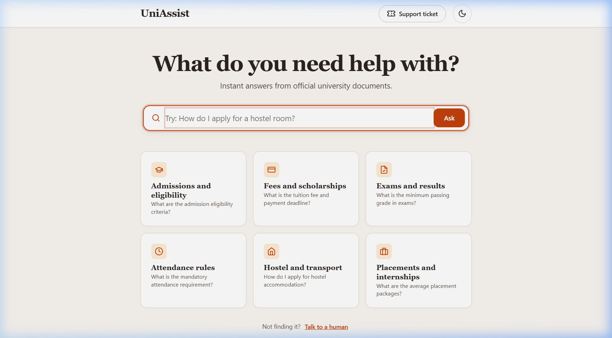
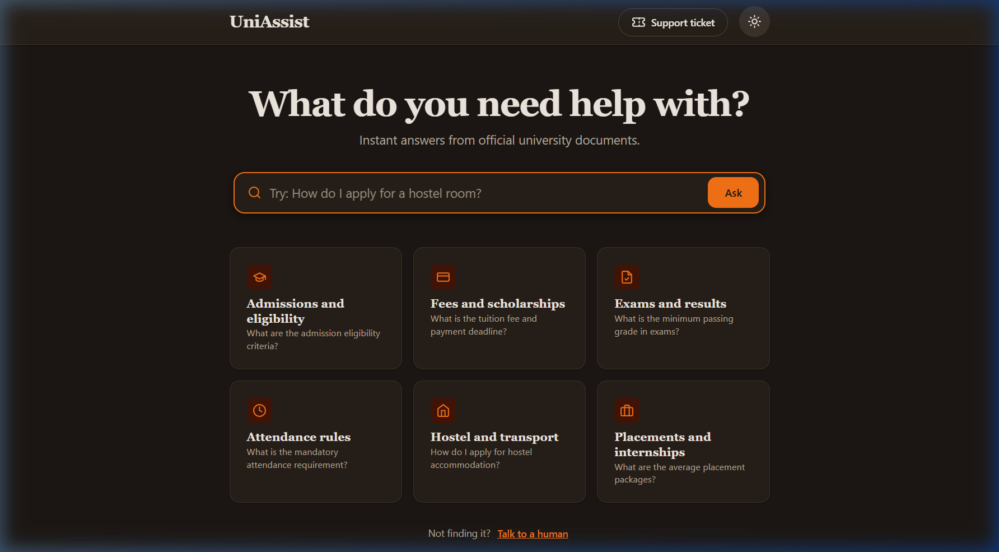
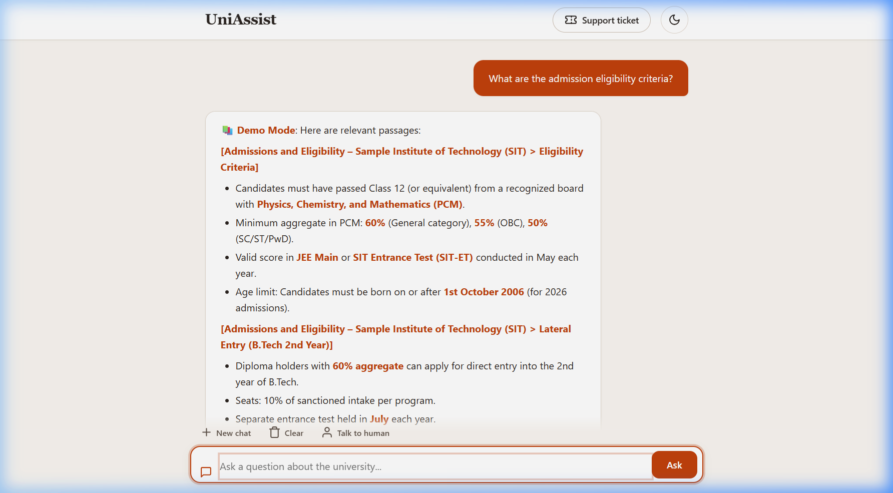
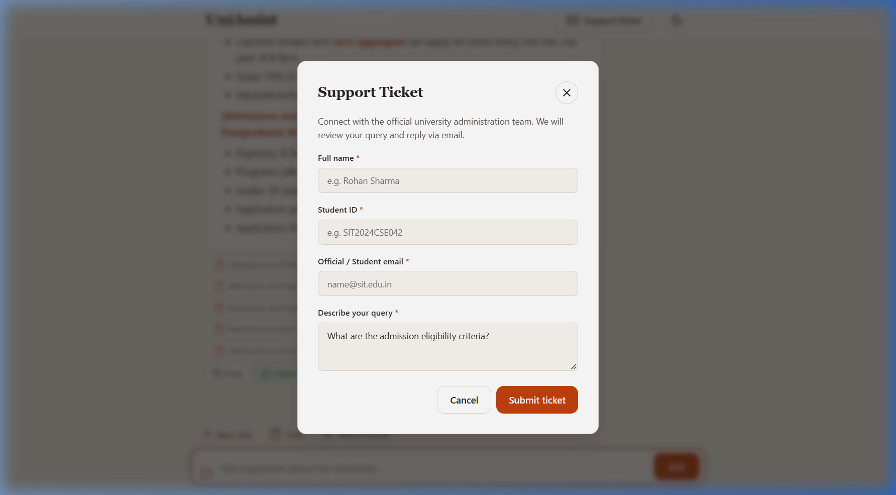
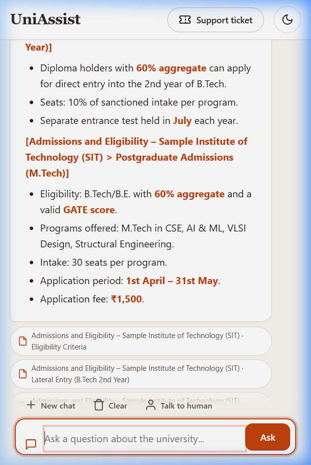
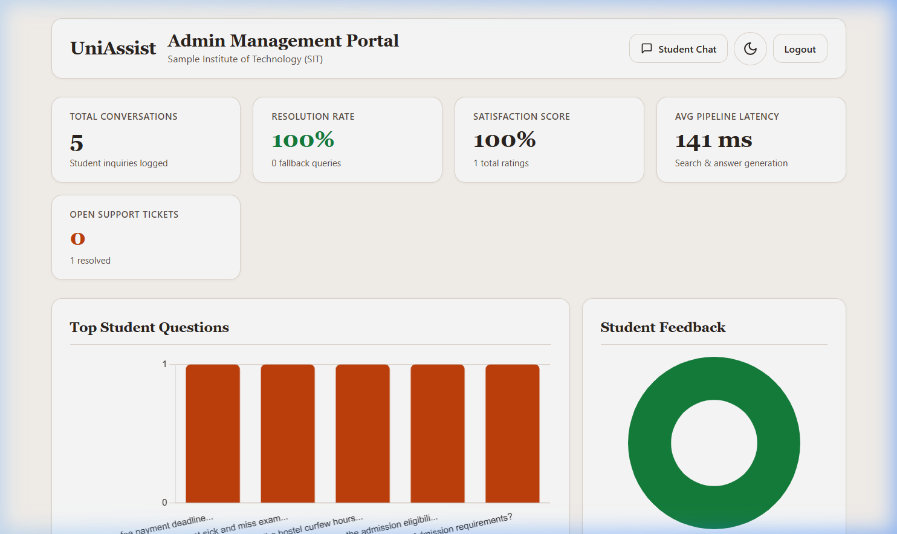

# UniAssist: AI-Powered Chatbot for University Student Support
> **Final Capstone Submission for HCLTech Digital-Data-AI Program**  
> Institution Domain: Higher Education & Student Administration (Sample Institute of Technology - SIT)

UniAssist is a production-ready, full-stack conversational AI assistant engineered to streamline student inquiries, academic navigation, administrative processes, and grievance reporting at university scale. Built using an asynchronous Python/FastAPI architecture with ChromaDB vector search and xAI Grok LLM integration, it provides grounded, hallucination-resistant answers with citations, guardrails, conversation memory, human ticket escalation, and a real-time administrative intelligence dashboard.

---

## 🌟 Key Features

### 1. Robust Retrieval-Augmented Generation (RAG)
- **ChromaDB Vector Store** with cosine similarity embeddings.
- Automatic semantic chunking with paragraph boundary awareness and configurable overlap.
- Document support: Markdown (`.md`), Plain Text (`.txt`), Adobe PDF (`.pdf`), Microsoft Word (`.docx`).
- Strict citation engine: every response cites document name and subsection.
- High similarity threshold with automated fallback for out-of-domain queries.

### 2. Multi-Tier Guardrails & Student Safety
- **Prompt Injection Defense**: blocks jailbreaks, system prompt leaking, roleplay exploitation, and API key probes.
- **Student Privacy & PII Masking**: automatic regex scrubbing for 10-digit Indian mobile numbers, emails, and Aadhaar numbers before persisting to logs.
- **Profanity & Abusive Language Filtering**: maintains polite and professional student engagement.
- **Scope Detection**: politely deflects non-university topics (crypto, movie trivia, etc.).

### 3. Asynchronous Streaming & Conversational Memory
- **Server-Sent Events (SSE)** via `/api/chat/stream` for real-time token streaming.
- **Session-Based Sliding Memory**: maintains up to 6 recent conversation turns per session with a 30-minute time-to-live (TTL) and thread-safe cleanup.
- Context-aware follow-up question suggestions.

### 4. Human-in-the-Loop Escalation
- Seamless escalation ticket modal with unique ticket identifiers (`TICK-YYYYMMDD-XXXX`).
- PII-masked query storage and admin ticket status workflow (Open → Resolved).

### 5. Administrative Dashboard & Analytics
- Visual KPI cards: Query volume, Resolution/Answer rate, Satisfaction %, Avg Latency, Ticket backlogs.
- Interactive Chart.js visualizations for top student inquiries and feedback distribution.
- Live Knowledge Base document uploading and one-click re-indexing.
- Protected by administrative authentication (`X-Admin-Password`).

### 6. "Ask First" Design System & User Interface
- **Search-First Paradigm**: Calm, warm page canvas (`#faf6f1` / `#1c1714` dark) with a prominent 16px radius search composer and 6 quick-topic discovery cards.
- **Fluid State Transition**: Smooth collapse from hero search to conversational view upon submitting the first inquiry.
- **Editorial Typography**: Headings rendered in bold `Georgia, serif` with high-readability body text and system fallback for Devanagari script (`Noto Sans Devanagari`).
- **Inline SVG System**: 100% vector line icons with zero external emoji dependencies for an enterprise academic feel.
- **Accessible & Responsive**: Fully WCAG AA contrast compliant, accessible focus rings, Esc-to-close modals with focus traps, and verified at 1440px, 1024px, 768px, and 390px viewports without horizontal scroll.

---

## 📸 Visual Preview

| Search-First Home (Light Theme) | Warm Dark Theme |
|---|---|
|  |  |

| Streaming Chat with Citations & Follow-ups | Human Escalation Support Modal |
|---|---|
|  |  |

| Mobile Responsive View (390px) | Admin Intelligence Dashboard |
|---|---|
|  |  |

---

## 🏗️ Technology Stack

| Layer | Technologies |
|---|---|
| **Backend API** | Python 3.11+, FastAPI, Uvicorn, Pydantic v2, pydantic-settings |
| **LLM & Inference** | xAI Grok API (`grok-4`, `grok-beta`) via official OpenAI SDK; Automatic model discovery & fallback; Direct RAG Demo Mode |
| **Vector Database** | ChromaDB (Persistent client with HNSW indexing) |
| **Relational Database** | SQLite with SQLAlchemy 2.0 ORM (`uniassist.db`) |
| **Security & Controls** | SlowAPI (Rate Limiting), HTTP Basic/Header Admin Auth, Regex PII sanitizer |
| **Frontend UI** | Semantic HTML5, Vanilla CSS3 (Glassmorphism, Dark/Light modes), JavaScript (SSE reader, DOMPurify, Marked.js, Chart.js) |
| **Testing & Eval** | Pytest, Pytest-Asyncio, HTTPX, Automated 30-question evaluation harness |

---

## 🚀 Quick Start Guide

### Prerequisites
- Python 3.11 or higher
- Windows PowerShell or Unix/macOS Terminal

### Step 1: Clone & Setup Environment
```bash
git clone <repo-url>
cd uniassist

# Create virtual environment
python -m venv .venv

# Activate virtual environment
# Windows:
.\.venv\Scripts\activate
# Linux/macOS:
source .venv/bin/activate

# Install dependencies
pip install -r requirements.txt
```

### Step 2: Configure Environment
Copy `.env.example` to `.env`:
```bash
cp .env.example .env
```
Edit `.env` (optional for LLM):
```ini
XAI_API_KEY=xai-your-api-key-here
XAI_MODEL=grok-4
ADMIN_PASSWORD=admin_sit_2024
DEMO_MODE=false
```
> **Note**: If `XAI_API_KEY` is not provided, UniAssist automatically launches in **DEMO MODE**, returning synthesized knowledge chunks and citations with zero errors.

### Step 3: Ingest Knowledge Base
Process and index all SIT university policy documents into ChromaDB:
```bash
python scripts/ingest.py
```

### Step 4: Run Application
```bash
# Using uvicorn directly:
uvicorn app.main:app --host 0.0.0.0 --port 8000 --reload

# Or on Windows using run.bat:
run.bat

# Or on Linux/macOS using run.sh:
chmod +x run.sh && ./run.sh
```

---

## 🌐 Application URLs

| Portal | URL | Credentials / Notes |
|---|---|---|
| **Student Chat Interface** | `http://localhost:8000/` | Public access, mobile responsive |
| **Admin Dashboard** | `http://localhost:8000/admin` | Password: `admin_sit_2024` (or configured value) |
| **Interactive API Docs (Swagger)** | `http://localhost:8000/docs` | OpenAPI 3.0 specification |
| **Health Check** | `http://localhost:8000/health` | Live diagnostic status |

---

## 🧪 Testing and Evaluation

### Run Test Suite
UniAssist includes unit and integration tests covering guardrails, conversation memory, RAG chunking, and API endpoints:
```bash
pytest tests/ -v
```

### Run Benchmark Evaluation Harness
Execute the 30-question evaluation benchmark against the AI pipeline:
```bash
python eval/run_eval.py
```
This benchmarks factual recall, prompt injection defense, abusive input deflection, and pipeline latency, saving detailed JSON metrics to `eval/eval_results.json`.

---

## 📂 Project Directory Structure

```text
uniassist/
├── .env.example            # Sample configuration settings
├── .gitignore              # Git ignore rules
├── requirements.txt        # Pinned dependencies
├── run.bat / run.sh        # Startup scripts
├── README.md               # Project guide and overview
├── ARCHITECTURE.md         # Detailed architectural design
├── PROJECT_REPORT.md       # Capstone submission report
├── DEMO_SCRIPT.md          # Step-by-step presentation script
├── app/                    # Application source code
│   ├── __init__.py
│   ├── config.py           # Configuration management
│   ├── database.py         # SQLAlchemy engine and session
│   ├── models.py           # SQLite tables (ChatLog, Feedback, Ticket)
│   ├── schemas.py          # Pydantic schemas
│   ├── llm.py              # Grok client with model auto-discovery
│   ├── rag.py              # ChromaDB vector index & retrieval
│   ├── memory.py           # Sliding conversation memory
│   ├── guardrails.py       # PII masking & injection safety
│   ├── escalation.py       # Ticket creation & management
│   ├── chatbot.py          # Core AI pipeline orchestrator
│   └── main.py             # FastAPI routes & static server
├── data/
│   └── knowledge_base/     # 12 SIT university policy documents (.md)
├── scripts/
│   └── ingest.py           # Ingestion CLI script
├── static/                 # Frontend assets
│   ├── index.html          # Student chat UI
│   ├── admin.html          # Admin dashboard & analytics
│   ├── style.css           # Modern theme & component styles
│   └── app.js              # SSE streaming & client logic
├── tests/                  # Pytest automated test suite
│   ├── conftest.py
│   ├── test_guardrails.py
│   ├── test_memory.py
│   ├── test_rag.py
│   └── test_api.py
└── eval/                   # Benchmark evaluation
    ├── test_questions.json # 30 benchmark test questions
    ├── run_eval.py         # Evaluation harness script
    └── eval_results.json   # Generated evaluation metrics
```

---

## 📜 License
MIT License. Submitted for HCLTech Digital-Data-AI Capstone Project.
