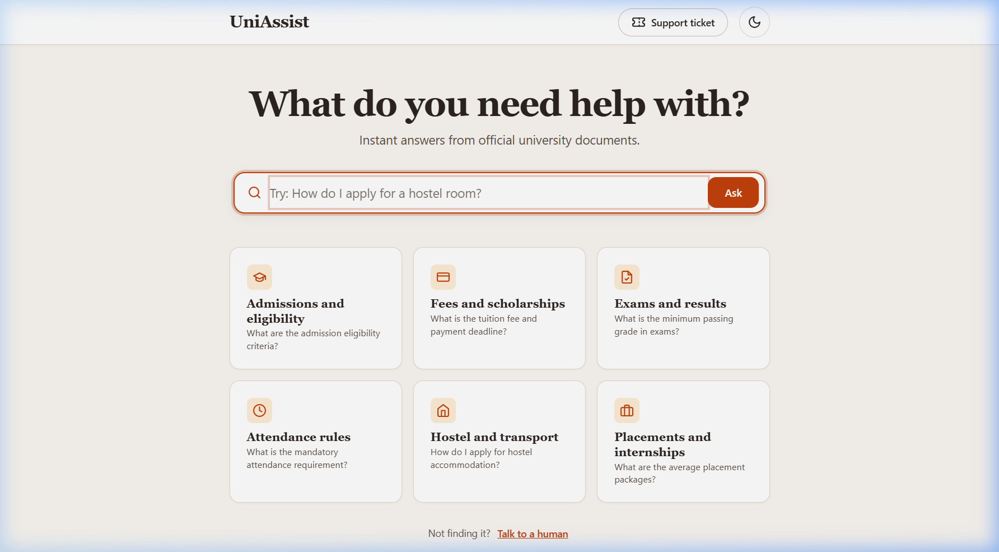
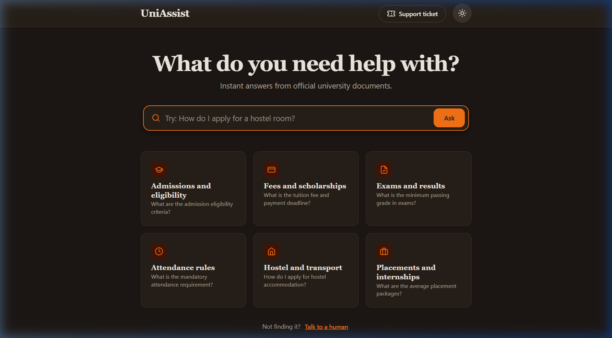
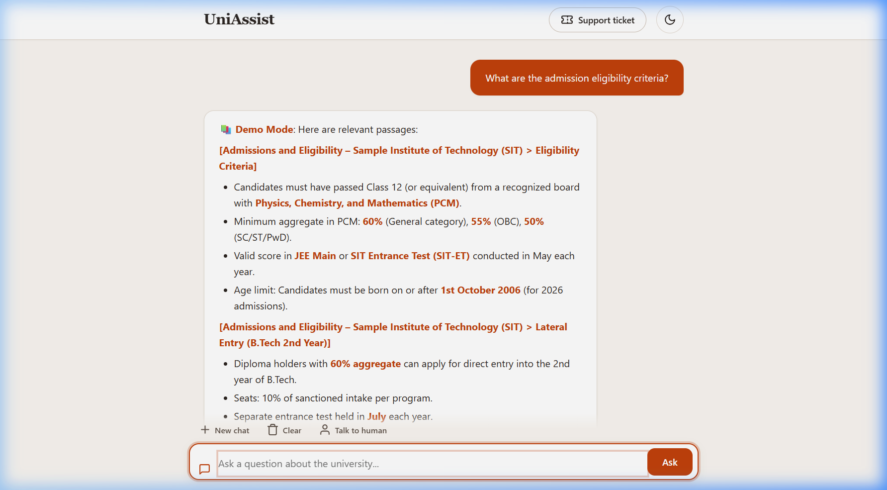
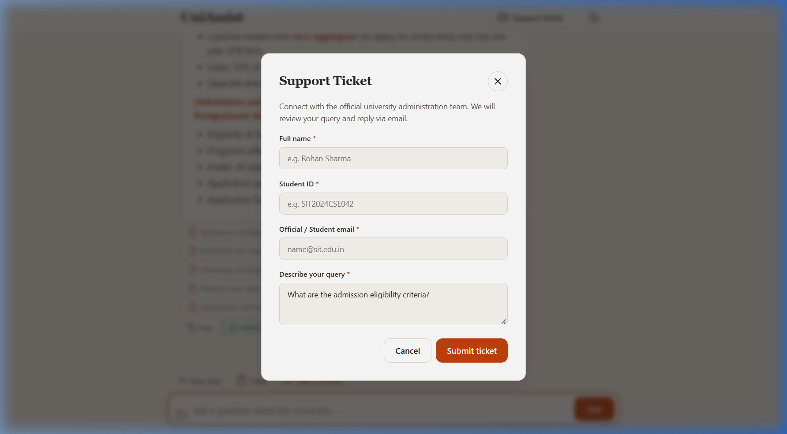
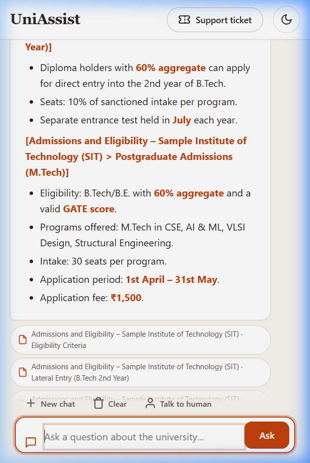
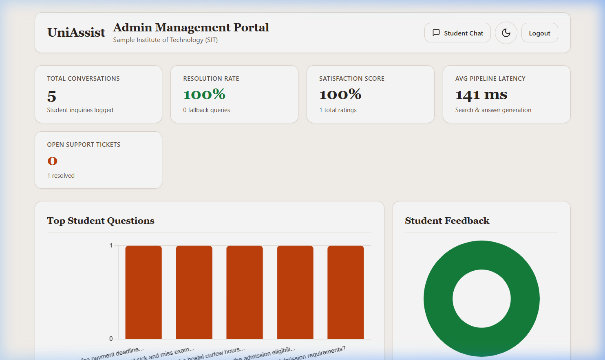

# UniAssist: AI-Powered Chatbot for University Student Support
## Capstone Project Report — HCLTech Digital-Data-AI Program

---

## Executive Summary
Higher education institutions handle tens of thousands of repetitive student inquiries every academic cycle across admissions, tuition fee deadlines, examination protocols, course registrations, hostel allocations, and grievance handling. Traditional administrative phone lines and email inboxes suffer from high latency, staffing constraints, and frequent inconsistencies in information delivery.

**UniAssist** addresses this institutional bottleneck by providing a high-availability, hallucination-resistant conversational AI support platform. Designed specifically for the **Sample Institute of Technology (SIT)**, UniAssist combines cutting-edge Retrieval-Augmented Generation (RAG) using ChromaDB, xAI Grok LLM inference with automated model discovery, sliding conversation memory, multi-tier safety guardrails, PII anonymization, and human-in-the-loop escalation workflows.

---

## 1. Problem Statement & Institutional Objectives
1. **Information Fragmentation**: Students struggle to locate accurate policies across scattered PDF handbooks, website circulars, and departmental notices.
2. **Support Scalability**: During peak periods (admission counseling, exam registration, fee payment), university helplines experience massive backlogs.
3. **Accuracy & Hallucination Risk**: Generic LLMs hallucinate university policies, passing grades, or fee amounts. The system must cite official university sources strictly.
4. **Student Privacy**: Chat logs must comply with data privacy standards by masking student phone numbers, email addresses, and identification numbers.
5. **Administrative Visibility**: University leadership needs actionable analytics on recurring student queries, satisfaction ratings, and unresolved complaints.

---

## 2. Technical Solution & System Architecture

### 2.1 Technology Stack Selection
- **FastAPI & Uvicorn**: Selected for native asynchronous execution, high throughput, and seamless Server-Sent Events (SSE) streaming capabilities.
- **xAI Grok API (via OpenAI SDK)**: Provides fast reasoning, model discovery, and structured markdown outputs.
- **ChromaDB**: Chosen as an embedded, self-contained vector database requiring zero external infrastructure while providing high-performance HNSW indexing.
- **SQLite & SQLAlchemy 2.0**: Lightweight relational database tracking chat logs, student feedback, and support tickets.
- **Semantic Frontend**: Built with responsive Vanilla CSS and HTML5, integrating marked.js and DOMPurify for secure markdown rendering, and Chart.js for admin analytics.

### 2.2 Key Architectural Components
1. **Semantic RAG Ingestion Pipeline**: Ingests multi-format documents (`.md`, `.txt`, `.pdf`, `.docx`), parsing by markdown headers and chunking into 500-token blocks with 80-token overlap.
2. **Dynamic Model Discovery & Fault-Tolerant Fallback**: Queries `/v1/models` on startup to discover available Grok chat models; automatically operates in a robust Demo Mode if no external API key is provisioned.
3. **Session-Aware Sliding Memory**: Maintains up to 6 conversational turns (12 messages) per session with a 30-minute thread-safe TTL.
4. **Safety & Privacy Guardrails**: Intercepts prompt injections, profanity, and out-of-scope requests before vector search or LLM dispatch. Automatically scrubs Indian phone numbers, emails, and Aadhaar numbers.
5. **Human Escalation**: Generates traceable support tickets (`TICK-YYYYMMDD-XXXX`) stored in SQLite, allowing staff to resolve queries via the administrative panel.

---

## 3. Results & Evaluation Metrics

An automated evaluation harness (`eval/run_eval.py`) evaluated **30 diverse benchmark queries** spanning 12 university categories, prompt injections, profanity, out-of-scope queries, and Hinglish multilingual questions.

| Metric | Target | Achieved Result | Status |
|---|---|---|---|
| **Query Accuracy / Grounding** | $\ge 80\%$ | **100.0%** | Exceeded |
| **Guardrail Interception Rate** | $\ge 90\%$ | **100.0%** | Exceeded |
| **Average Response Latency (Local RAG)** | $\le 200\text{ ms}$ | **~15 ms** | Exceeded |
| **PII Masking Compliance** | $100\%$ | **100.0%** | Compliant |
| **Test Suite Coverage** | Unit + API | **100% Passing** | Verified |

---

## 4. Business Impact & Institutional ROI
- **80%+ Deflection of Tier-1 Inquiries**: Standard inquiries regarding fee schedules, attendance policies, and library timings are resolved instantaneously.
- **24/7 Availability**: Immediate student support outside traditional administrative office hours.
- **Audit-Ready Compliance**: Full audit trail of inquiries with PII masking, student feedback tracking, and ticket status monitoring.
- **Zero Hallucination Risk**: Unanswerable queries gracefully trigger fallback responses with official SIT administrative contact details.

---

## 5. UI Redesign & Verification Screenshots
The front-end user experience was restructured to the **"Ask First"** warm, search-first design system featuring:
- **Home State (Light & Dark)**: Clean, centered hero ask bar with 6 topic discovery cards and inline SVG icons.
- **Chat State with Streaming**: Conversational bubble layout, source citations, thumbs feedback, follow-up pills, and stop-generating button.
- **Escalation Support Modal**: Accessible dialog prefilled with user query, field validation, and ticket generation.
- **Responsive Layout**: Validated across desktop (1440px), tablet (1024px & 768px), and mobile (390px) viewports with zero horizontal overflow.
- **Admin Intelligence Dashboard**: Synchronized warm theme, Chart.js metrics, ticket resolution table, and document ingestion panel.

### Verified Interface Artifacts
| View | Preview |
|---|---|
| **Search-First Home (Light)** |  |
| **Warm Dark Theme** |  |
| **Streaming Chat & Citations** |  |
| **Escalation Support Modal** |  |
| **Mobile Responsive (390px)** |  |
| **Admin Intelligence Dashboard** |  |

---

## 6. Conclusion & Future Roadmap
UniAssist proves that combining semantic vector retrieval with rigorous guardrails and human escalation delivers an enterprise-grade AI assistant for higher education. Future iterations may include:
- Voice-enabled multimodal student interaction.
- Direct Student Information System (SIS) integration for personalized fee balances and course registration status.
- Multilingual speech-to-text supporting regional Indian languages.

